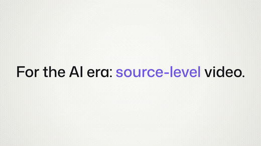
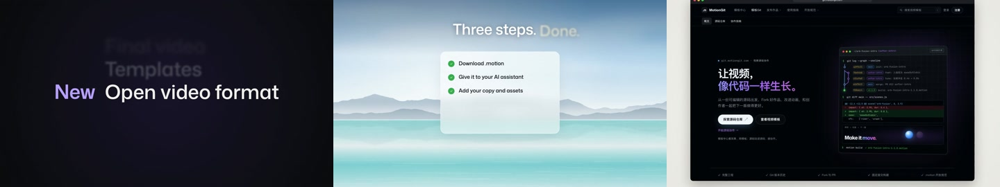

# 发布会舞台 · 产品演示

以发布会舞台和大屏展示组织产品演示，适合新品介绍、功能发布与品牌展示。

**16:9 · 1920 × 1080 · 60 fps · v2.6.4** · [@motiongit](https://motiongit.com/@motiongit) · [English](README.md)

**[模板详情、完整 .motion 与 Demo](https://motiongit.com/@motiongit/motiongit-promo-keynote)**
https://motiongit.com/@motiongit/motiongit-promo-keynote

下载已开放，当前许可见模板页面与下载包。

## Demo

[查看完整样片](https://motiongit.com/@motiongit/motiongit-promo-keynote) · [播放视频](https://media.openaicut.com/previews/591/draft-en-28eb07a5a332.mp4)

## 技术原理

- 声明的运行配置：html-canvas/1。
- 通过模板参数和预设，将本期文字、数据或素材映射到已有动画工程。
- 已声明时长随本期内容适配，最终节奏由包内制作计划确定。

样片时长: **108s**. 已声明输出为 1920 × 1080，60 fps；公开样片 108 秒。 按实际包的参数边界制作；增加素材不会自动增加场景。

## 输入素材与内容

- **必需:** 本期主题、文稿与需要准确保留的信息。
- **可选:** 本期配音文件，或是否需要配音的安排。
- **可选:** 本期已授权配乐，或本期是否需要配乐的偏好。
- **可选:** 本期产品图片、截图或展示素材，按所选槽位支持的类型准备。
- **可选:** 本期视频片段，按所选场景或声明素材槽位使用；原声按模板的独立音频说明处理。

适用内容: Fixed landscape animation using the listed public text/display-data/palette slots, current narration and independently supplied licensed music.

## 运行环境

- 模板声明使用 Python 和 Node.js。具体工具与版本以下载包为准。
- 按下载包的依赖锁和 setup/check 说明检查已有工具，只补齐缺项，并验证预览。

## 使用模板

1. 从[模板页面](https://motiongit.com/@motiongit/motiongit-promo-keynote)获取当前版本的完整 .motion。
2. 按包内说明解压或加载，读取 README 和引用的制作指南。
3. 使用本期内容与素材，复用已有环境，按包内入口制作并查看实际预览。

可将下面这段请求与仓库地址交给助手：

> https://github.com/motiontemplates/667934
>
> 请使用这个 .motion 模板制作。模板地址：https://motiongit.com/@motiongit/motiongit-promo-keynote。取得模板后按其说明解压或加载，读取包内 README 和引用的指南，复用已有环境，用我的内容制作并展示实际预览。

## .motion 格式

MotionGit .motion 是可复用的视频模板格式，组织动画工程、参数、素材、依赖与制作指南。运行时按本期内容再次制作，输出 MP4 等成片。 [格式说明](https://motiongit.com/spec)

[版本、许可与完整下载](https://motiongit.com/@motiongit/motiongit-promo-keynote) · [制作参考](ASSISTANT.zh-CN.md)
